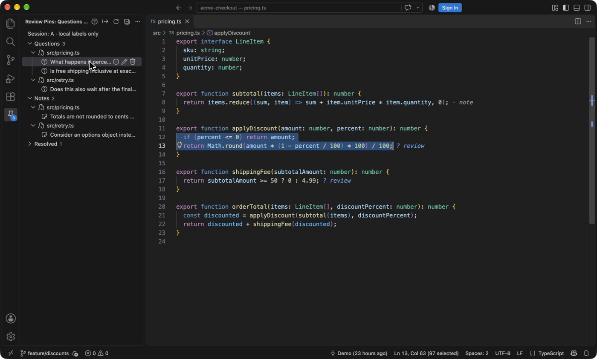
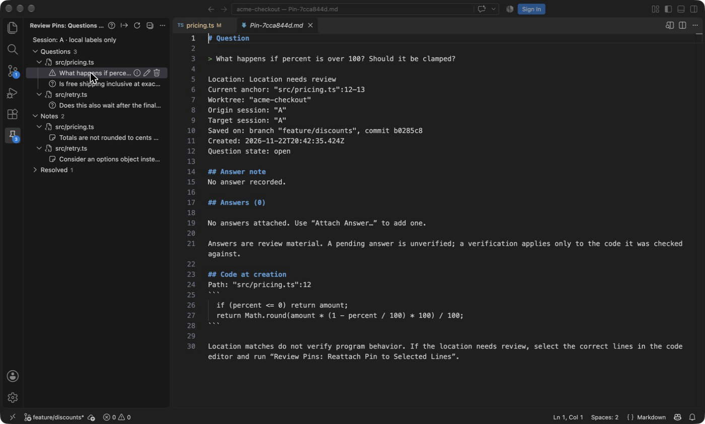
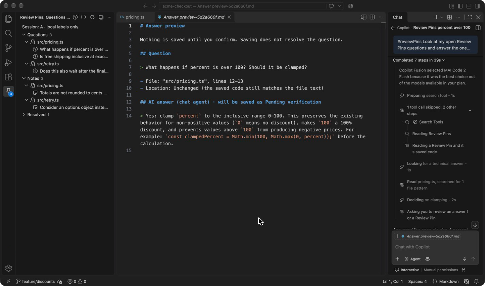
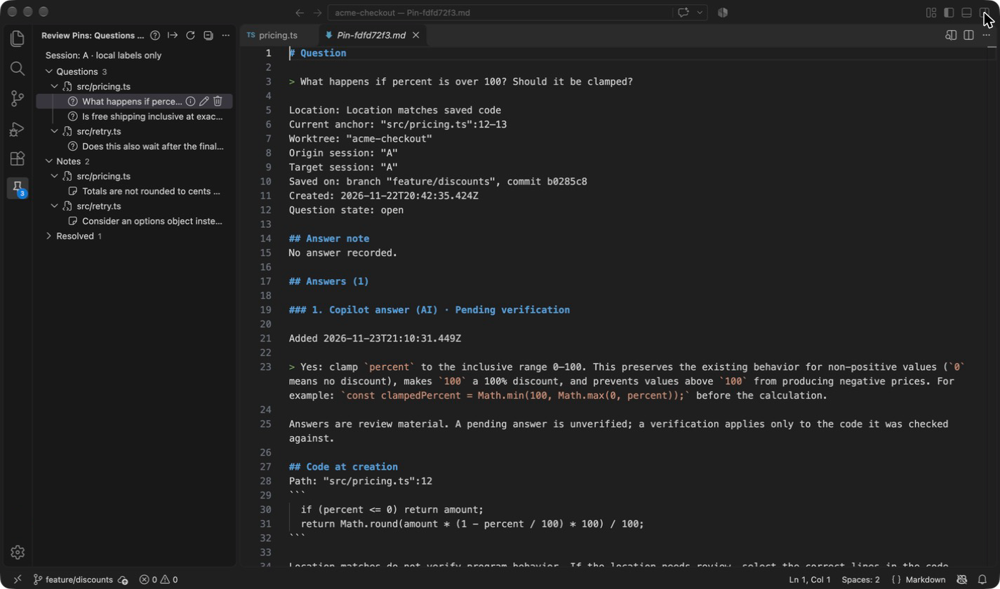

# Review Pins

Pin questions and notes to the exact lines of code that prompted them. Track when that code changes, ask an AI agent about them, and keep a human in charge of what counts as answered.

Review Pins runs locally. It has no accounts or telemetry and makes no network calls itself. AI features work only through tools you invoke in your own VS Code chat (for example GitHub Copilot in Agent mode) or through text you copy.

> **Early release (v0.1.0).** Tested on macOS with VS Code 1.147. Windows, Linux, VSCodium and VS Code versions older than 1.147 have not been tested yet. The declared minimum is VS Code 1.100.

## Features

- **Questions and notes on code.** Select lines in a saved file, then add a question (open or resolved) or a note.
- **One place to find them.** The Review Pins view groups pins into Questions, Notes and Resolved, then by file. Pinned lines are marked in the editor.
- **Honest about code changes.** When pinned code changes, moves or is deleted, the pin is marked STALE or MISSING and shows the code as it was saved, instead of highlighting a guess. Reattaching is always explicit.
- **Ask AI about a pin.** Copilot in Agent mode can list your pins and read one with its saved code and current location state. Or copy a ready-made prompt for any AI chat.
- **Answers with human verification.** Attach an answer from Copilot, another AI tool or yourself. Every answer starts as *pending verification*; you verify it against the current code and resolve the question yourself.
- **Worktree-aware.** Pins belong to one Git worktree, so parallel worktrees with the same files stay separate.

## Getting started

1. Install **Review Pins** from the Extensions view. You need VS Code desktop 1.100 or newer and Git on your `PATH`.
2. Open a trusted, local Git repository or worktree (one folder; not remote or multi-root).
3. In a saved file, select some lines, right-click, and choose **Review Pins: Add Question** or **Add Note**. With no selection, the current line is used.
4. Open **Review Pins** in the activity bar. Select a pin to jump to its code. Hover a pin for **Details**, **Edit** and **Delete**; right-click for everything else.

## Ask Copilot about your pins

Review Pins adds three tools to VS Code chat through the Language Model Tools API:

| Tool | Reference | What it does |
|---|---|---|
| List Review Pins | `#reviewPins` | Lists questions and notes in this worktree with status, file, lines and location state. Read-only. |
| Get Review Pin Context | `#reviewPinContext` | Returns one pin: its text, the saved code, whether the location still matches, the current text when it changed, and saved answers. Read-only. |
| Propose Review Pin Answer | `#reviewPinsProposeAnswer` | Offers an answer. Nothing is saved unless you approve it in Review Pins' own dialog. |

1. Install and sign in to GitHub Copilot Chat. Review Pins works the same without it.
2. Open Chat, switch to **Agent** mode, and enable the three Review Pins tools under **Configure Tools**.
3. Ask, for example: *"Look at my open Review Pins questions and answer the first one."*
4. To keep the answer, ask *"Save that answer to the pin."* Read the preview, then choose **Save as Copilot Answer**, **Save as Other AI Answer**, or **Cancel**.

The tools only see the worktree open in that window. They cannot resolve pins, verify answers, edit files or run code. Pin text and code are marked as review material, not instructions. Extensions cannot read Copilot's chat history, so an answer is captured only when the agent passes it to the propose tool or you paste it yourself.

## Answers and verification

Right-click a question:

- **Attach Answer…**: choose who produced it (Copilot, another AI tool, or you), paste or type it, check the preview, and save. Answers are added; nothing is replaced.
- **View Answers**: each answer is labelled *Copilot answer (AI)*, *AI answer (tool)*, or *Manual answer*, and *Pending verification*, *Verified*, or *Verified for earlier code; re-check*.
- **Mark Answer Verified…**: confirm you checked an answer against the current code. This is refused while the location is stale; reattach the pin first.
- **Resolve Question** / **Reopen Question**: separate from verification. Reopening keeps all answers.

A verification applies only to the code it was checked against. If that code changes or the pin is reattached, the answer shows *re-check*.

## Other ways to share context

- **Ask AI (Copy Prompt)** and **Copy with Context** (right-click a pin): preview a prompt with the pin, its saved code and location state, then copy it to paste into any AI chat.
- **Hand Off Questions** (view toolbar): bundle unresolved questions for your next coding session, preview, copy, and record the target session label.

Copied text uses repository-relative paths and a worktree folder name. It leaves out absolute paths, internal pin IDs and full commit hashes. Nothing is copied until you confirm.

## Code changes and reattaching

Pins store whole lines plus neighboring lines. If they no longer match, or the file has unsaved edits, the pin needs review and opens its saved details. Select the right lines and run **Review Pins: Reattach Pin to Selected Lines** to update the location; the original code and origin are kept. A text match never proves program behavior.

## Privacy and data

- Pins live in VS Code's extension storage on this computer, per worktree. Nothing is added to your repository, and source files are never modified.
- Stored data includes selected code, nearby lines, questions, notes, answers, local paths and session labels. The extension does not encrypt it. Uninstalling may leave VS Code's stored data behind.
- When an AI tool runs, its output (pin text, saved code, ids) goes to the model your chat client uses. Turn the tools off in **Configure Tools** if you do not want that.

## Known limitations

- Tested on macOS only (VS Code 1.147). Windows, Linux and VSCodium are untested.
- One local workspace folder inside a Git worktree. Remote, multi-root, and nested repositories opened through a parent are not supported.
- Files up to 2 MB; selections up to 8,000 characters; up to 2,000 pins (24 MB) per worktree; up to 20 answers per question.
- No automatic tracking across renames or rebases. Moving a worktree directory starts a new, empty pin store.
- Typed answers are single-line; paste longer answers from the clipboard. Individual answers cannot be deleted or un-verified yet.
- Session labels are labels you assign, not connected agent sessions.
- If a VS Code window crashes mid-write, close all Review Pins windows and delete the `pins.json.lock` file named in the error.

## Contributing

See [CONTRIBUTING.md](CONTRIBUTING.md) for building, testing and reporting issues.

## License

[MIT](LICENSE). The extension icon uses the Noto Emoji pushpin (Apache License 2.0); see [NOTICE](NOTICE).
